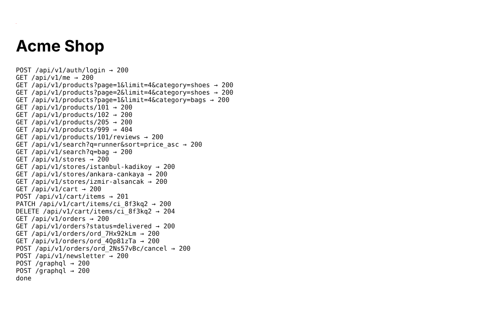
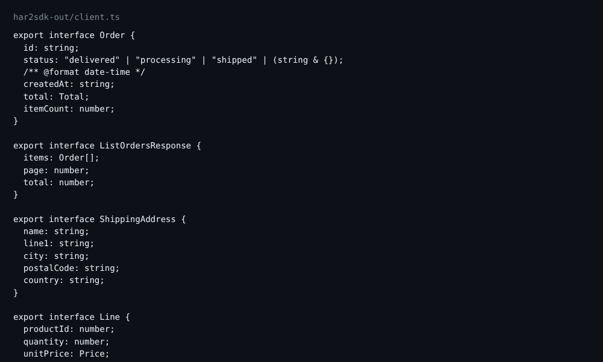
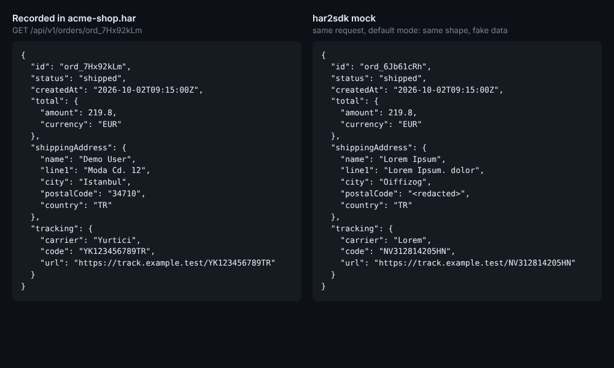
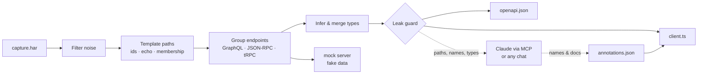

<div align="center">

# har2sdk

**Record a web app's network traffic in your browser. Get a typed TypeScript client for its API.**<br>
`capture.har` → `client.ts` + `openapi.json` + a mock server. Runs locally, deterministic, no API key.

[](https://github.com/Mersbyte/har2sdk/actions/workflows/ci.yml)
[](https://www.npmjs.com/package/har2sdk)
[](LICENSE)




</div>

```bash
npx har2sdk capture.har
```

Figuring out an undocumented API in DevTools → Network takes an afternoon: which endpoints exist, what the ids look like, which fields are optional, what auth it wants. har2sdk does it in one command for JSON APIs — REST, GraphQL, JSON-RPC and tRPC — and gives you a client you can import:

```ts
import { AcmeShopClient } from "./har2sdk-out/client.js";

const shop = new AcmeShopClient({ token: process.env.TOKEN });

const page = await shop.listProducts({ category: "shoes", page: 1, limit: 4 });
page.items[0].price.amount;            // number

const orders = await shop.listOrders({ status: "delivered" });
orders.items[0].status;                // "delivered" | "processing" | "shipped" | (string & {})

const order = await shop.getOrder({ orderId: "ord_7Hx92kLm" });
order.shippingAddress.city;            // string
```

All of that was inferred from one recording of the [demo shop](examples/demo-shop) — a small fake app clicked through by a real Chromium — with no spec and no config.

## Quick start

1. **Record.** Open the app, DevTools → **Network**, tick *Preserve log*, use the app, then click **Export HAR** (⤓) in the Network toolbar — or right-click a request → *Save all as HAR*.
2. **Generate.**
   ```bash
   npx har2sdk capture.har            # → har2sdk-out/client.ts + openapi.json
   npx har2sdk inspect capture.har    # only list what was found
   ```
3. **Use it** — or develop offline against a mock that answers like the real API, with fake data:
   ```bash
   npx har2sdk mock capture.har       # → http://localhost:4010
   ```

Needs Node 20+. Reads standard HAR 1.2: tested with Chrome-style exports and Playwright recordings by Chromium ([fixtures](test/fixtures/browsers)). Firefox, Safari, mitmproxy, Charles and Proxyman write the same format but have no fixtures yet — if one trips it up, please open an issue with `har2sdk inspect --json` output (never the HAR itself).

<table>
<tr>
<td width="50%"><br><sub>The fake demo shop in Chromium: 28 API calls (REST, GraphQL, a 404, a 204…) recorded into <code>acme-shop.har</code>.</sub></td>
<td width="50%"><br><sub>Part of the generated <code>client.ts</code>: named types, an open enum for <code>status</code>, formats.</sub></td>
</tr>
<tr>
<td colspan="2"><br><sub>Left: what was recorded. Right: what <code>har2sdk mock</code> serves for the same request — same shape and vocabulary, fake ids, names and address.</sub></td>
</tr>
</table>

## What it figures out

| | |
|---|---|
| **Noise vs. API** | Drops images, fonts, scripts, page loads, CORS preflights, failed requests, ~80 analytics/ads/consent hosts and common first-party telemetry (`/g/collect`, `/_vercel/insights`, Sentry tunnels, fire-and-forget POSTs to `…/rum`, `…/beacon`). First-party drops are listed in a warning; `--include-path`, `--exclude-host` and `--exclude-path` adjust it. |
| **Path parameters** | `/users/42/orders/ord_9f8a` → `/users/{userId}/orders/{orderId}`: numbers, UUIDs, ULIDs, prefixed ids, issue keys (`PROJ-7`), phone numbers, dates. Word-like segments become parameters on evidence from the capture: the response echoes the value as its own id (`/users/alice` → `{ "login": "alice" }`), a list response names its items by it (`/users/{u}/repos` lists `dotfiles` → `/repos/{owner}/{repo}`), or it was recorded as a user or tenant name. `/products/featured` stays an endpoint. Also: `{id}.json`, file names, locales (`/en-us/`), tenants (`/orgs/acme/`), dated API versions (`/api/2024-01/`). Wrong guess? `--param "/users/{login}"`. |
| **Types** | Merges every sample: optional vs. required, nullable, formats (`date-time`, `uuid`, `email`, `uri`), dictionaries keyed by ids or other data as `Record<string, T>`. Categorical fields (`status`, `type`, `currency`…) get open enums — `"a" \| "b" \| (string & {})` — autocomplete without breaking on new values. Identical shapes are one type (`type Total = Price`). |
| **Responses** | Different 2xx shapes become a union; recorded error bodies get a type per status and a guard (`if (isGetFileError(err)) err.body`). Bodies the browser didn't record become `unknown` (a multipart upload `FormData`), with a warning — request and response bodies alike. |
| **GraphQL & RPC** | Every GraphQL operation (named, anonymous, batched, GET, persisted), JSON-RPC 1.0/2.0 method and tRPC procedure is its own typed method. Data-carrying inline values in recorded documents (`user(id: 4815162342)`, `login(username: "…")`) become variables; small numbers and enum values stay. tRPC superjson: JSON values and the `meta` the app sent. |
| **Auth & headers** | Bearer/`Token` schemes, Basic, API-key headers or query params, session cookies (trackers ignored), CSRF headers. Version/platform headers (`x-app-version: 3.4.1`) become defaults; other custom headers are only listed by name. |
| **Several captures** | `har2sdk a.har b.har` merges them into one SDK. |

The generated `client.ts` has **zero dependencies**, uses the global `fetch` (Node 20+ and browsers), and compiles under `strict`, `exactOptionalPropertyTypes` and `erasableSyntaxOnly`. Non-2xx responses throw `ApiError` with the parsed body.

## Auth

The capture tells har2sdk *how* the app authenticated, never *with what*. The token, cookie or key you recorded is not copied into `client.ts` (if it were, the [leak guard](#privacy) would refuse to write the file). You pass your own:

```ts
new AcmeShopClient({ token: process.env.TOKEN });  // a string
new AcmeShopClient({ token: () => getToken() });   // or a function, sync or async
```

- **Which options you get** depends on what the capture used: `token` (sent in `Authorization` with the scheme the app used, e.g. `Bearer …` or `Token …`, or bare if the app sent it bare; `Bearer` if no auth was seen), `basicAuth`, `apiKey` (in the header or query parameter the app used) and `cookie`. If no auth was seen, you get `token`.
- **A token function is called before every request**, so it can hand out a fresh token each time. For anything else computed per request (a CSRF header, a signature), pass `headers: async () => ({ … })`.
- **Refreshing is up to you.** On a `401` the client doesn't retry or refresh: it throws `ApiError` with `status`, the parsed `body` and the `operation` that failed. One way to handle it:

  ```ts
  import { AcmeShopClient, ApiError } from "./har2sdk-out/client.js";

  let token = await login();
  const shop = new AcmeShopClient({ token: () => token });

  async function withRefresh<T>(call: () => Promise<T>): Promise<T> {
    try {
      return await call();
    } catch (err) {
      if (!(err instanceof ApiError) || err.status !== 401) throw err;
      token = await refresh();
      return call();
    }
  }

  const me = await withRefresh(() => shop.getMe());
  ```

- **The mock doesn't check auth.** Any token, or none, gets the same response.

## Privacy

HAR files contain live session cookies, tokens and often other people's data. har2sdk:

- **runs on your machine.** The CLI makes no network requests.
- **keeps recorded values out of the generated files.** What *is* taken from the capture: the base URL, path segments and property names judged to be names of things, version/platform header values, vocabulary enum values (`"shipped"`), and GraphQL documents with their data-carrying values lifted into variables.
- **has a leak guard.** Before generating, it collects every recorded value that looks like data (ids, emails, phone numbers, free text, values under personal, secret or id keys in five languages) and every value the capture uses as a user or tenant name (under `login`, `owner`, `reviewer`… or in `x-user` headers — `okilic` too, in any spelling). The generator consults that set for every path literal, enum member, property name and header default. Then every output is scanned: if `client.ts` or `openapi.json` contains a recorded value, **nothing is written** (exit status 2, masked previews; `--allow-leaks` overrides). The chat prompt, MCP responses and `inspect --json` get such values replaced by `<redacted>`.
- **serves fake data from the mock** (and `--examples`): same shape, consistent fake ids, masked names, emails, addresses and free text — for JSON, XML, CSV and text bodies. The mock listens on `127.0.0.1`, rejects foreign `Host` headers (DNS rebinding) and allows CORS only from `localhost` and the recorded origins. `--raw` serves the recorded bodies unscrubbed.

The guard is a heuristic with evidence from the capture, not a proof: a value with **no evidence anywhere** (a word used once as a path segment that nothing else names) can't be recognised, and one-word names of things (a category `"Books"`) are treated as vocabulary. Look over `har2sdk inspect` before publishing generated code. Details, and exactly what is and isn't collected: [SECURITY.md](SECURITY.md).

It's tested with the inputs of eleven review rounds (`test/review*.test.ts`) and a generated privacy test that builds a random person and hides them in 30 kinds of places in a random capture, then checks every output, including a real MCP session, the CLI's `inspect --json` and every mock response (30 seeds in CI; the long run of 1,000 seeds passes).

**Treat `.har` files like passwords.** **Use it responsibly:** reverse-engineering an API you don't own can break its terms of use. Good uses: your own apps, legacy internal systems, services you're allowed to integrate with. Please don't publish SDKs for other companies' services.

## Better names with Claude — no API key

The engine is deterministic; naming is where a language model helps. What a model sees: endpoint paths (ids already `{params}`), parameter names, inferred types and GraphQL documents — checked against the leak guard's values first. Accepted names are saved to `har2sdk.annotations.json`, so later runs are reproducible.

**MCP server** (Claude Code, Claude Desktop, Cursor, any MCP client):

```bash
claude mcp add har2sdk -- npx -y har2sdk mcp
```

<details><summary>Claude Desktop / Cursor config</summary>

```json
{
  "mcpServers": {
    "har2sdk": { "command": "npx", "args": ["-y", "har2sdk", "mcp"] }
  }
}
```

On Windows, if the server doesn't start, use `"command": "cmd", "args": ["/c", "npx", "-y", "har2sdk", "mcp"]`.
</details>

Then ask: *"Turn ~/Downloads/capture.har into an SDK with great names."* Claude calls `analyze_har`, `inspect_endpoint` and `generate_sdk`. The server writes to `har2sdk-out` next to the HAR file; `out_dir` must stay inside the HAR's folder, the server's working directory (not `/` or your home folder) or the temp directory. It never writes through a symbolic link (a linked `har2sdk-out` or `har2sdk.annotations.json` is an error).

**Any chat, copy & paste:** `npx har2sdk prompt capture.har --copy`, paste the prompt, save the JSON reply as `har2sdk-out/har2sdk.annotations.json`, then run `npx har2sdk capture.har` again.

<details><summary>Annotation format</summary>

```json
{
  "clientName": "AcmeShopClient",
  "endpoints": {
    "POST /api/v1/newsletter": {
      "name": "subscribeToNewsletter",
      "description": "Subscribe an email address to the newsletter.",
      "tag": "marketing"
    },
    "GET /api/v1/stores/{storeId}": { "params": { "storeId": "slug" } }
  },
  "types": { "Price": "Money" }
}
```
</details>

## How it works



## CLI

```text
har2sdk <capture.har…> [options]          Generate client.ts + openapi.json (several captures are merged)
har2sdk inspect <capture.har…> [--json]   List the endpoints that were found
har2sdk prompt <capture.har…> [--copy]    Prompt to paste into any AI chat for better names
har2sdk mock <capture.har…> [--port 4010] Replay the API locally with fake data
har2sdk mcp                               Start the MCP server

-o, --out <dir>          Output directory (default: ./har2sdk-out)
--host <host>            Only include this host (repeatable)
--exclude-host <host>    Drop this host (repeatable)
--exclude-path <glob>    Drop matching paths, e.g. "/telemetry/*" (repeatable)
--include-path <glob>    Keep matching paths even if they look like telemetry (repeatable)
--param <pattern>        Force a path parameter: "/users/*", "/users/{login}", or "users/*" anywhere (repeatable)
--base-url <url>         Base URL baked into the SDK
--name <ClientName>      Class name
--annotations <file>     Names/descriptions to apply
--examples               Embed examples in openapi.json (fake data with the recorded shape)
--allow-leaks            Write files even if the leak guard finds a recorded value in them (default: refuse)
--no-enums               Don't emit literal unions
--no-merge               Don't merge sibling paths into {params}
--bind <address>         (mock) Interface to listen on (default 127.0.0.1)
--raw                    (mock) Serve recorded bodies unscrubbed (default: fake data)
```

## Programmatic API

```ts
import { generateFromHar, loadHarFile, analyzeExchanges, generateFromModel } from "har2sdk";

const { files, model, warnings, leaks } = generateFromHar(harText, { hosts: ["api.example.com"] });
files["client.ts"];      // string
files["openapi.json"];   // string
leaks;                   // recorded values found in the files (masked previews), normally []

// Large files: stream them.
const exchanges = await loadHarFile("capture.har");
const result = generateFromModel(analyzeExchanges(exchanges), exchanges);
```

## How it compares

| | Typed client | OpenAPI | GraphQL / RPC methods | Mock server | LLM / API key | Where it runs |
|---|:-:|:-:|:-:|:-:|:-:|:-:|
| **har2sdk** | ✅ TypeScript | ✅ 3.1 | ✅ | ✅ | Not needed (optional naming) | Local |
| [mitmproxy2swagger](https://github.com/alufers/mitmproxy2swagger) | via a generator | ✅ 3.0 | — | — | No | Local |
| [har-to-openapi](https://github.com/jonluca/har-to-openapi) | via a generator | ✅ 3.0/3.1 | — | — | No | Local |
| [OpenAPI DevTools](https://github.com/andrewwalsh/openapi-devtools) | via a generator | ✅ 3.1 | — | — | No | Browser extension |
| [Integuru](https://github.com/Integuru-AI/Integuru) | Python scripts | — | — | — | Yes (OpenAI) | Local + OpenAI |
| [reverse-api-engineer](https://github.com/kalil0321/reverse-api-engineer) | ✅ many languages, LLM-written | — | — | — | Yes | Local + model provider |

The OpenAPI tools pair well with a generator such as [orval](https://orval.dev) or [hey-api](https://heyapi.dev); mitmproxy2swagger's explicit review step for path templates is a good idea when you want full control. Agent tools let a model read the traffic and write the client — flexible and multi-language, but they need a model and key, send the capture to it, and produce different code on each run. har2sdk is one deterministic step from recording to an importable client, with a model only for names if you want one.

## Limitations

- Types describe what was **observed**: fields that never showed up are missing, fields seen once may look required. Record more, or pass several HARs.
- Heuristics can mis-template paths. Check `har2sdk inspect`; fix with `--param` or annotations.
- Not modelled yet: APIs multiplexed through a query parameter (`index.php?route=…`), protobuf / gRPC-web, WebSockets, Server-Sent Events, request chains (fetch a CSRF token, then call — pass such headers with `headers: async () => ({ … })`).
- The same method + path on two origins: the SDK has both, `openapi.json` keeps one (with a warning). JSON-RPC over one URL is one OpenAPI operation with a body variant per method.
- Large captures are read as a stream, but every request is kept in memory. Synthetic capture (API JSON, base64 images, JS bundles), Node 22, 4 vCPU, `har2sdk capture.har`:

  | capture | 0.5.0 | 0.6.0 |
  |---|---|---|
  | 200 MB, 8,191 requests | 11 s, 713 MB peak RSS | 11 s, ~420 MB peak RSS |
  | 600 MB, 24,622 requests | refused ("too large to load in one piece") | 39 s, 979 MB peak RSS |

Known issues: [docs/KNOWN-ISSUES.md](docs/KNOWN-ISSUES.md).

## Development

```bash
npm install
npm test               # builds, then runs unit, review, browser-fixture, MCP and end-to-end tests
npm run demo:record    # re-record examples/demo-shop/acme-shop.har with Playwright (see examples/demo-shop)
HAR2SDK_FUZZ_SEEDS=1000 npx vitest run test/privacy-fuzz.test.ts   # the long privacy run
```

The suites type-check generated SDKs under `--strict`, run them against the mock server and stubbed `fetch`, validate `openapi.json` against the official OpenAPI 3.1 schema, and run the generated privacy test.

har2sdk is an independent open-source project and is not affiliated with Anthropic; "Claude" refers to the assistant you may use with it.

## License

[MIT](LICENSE)
